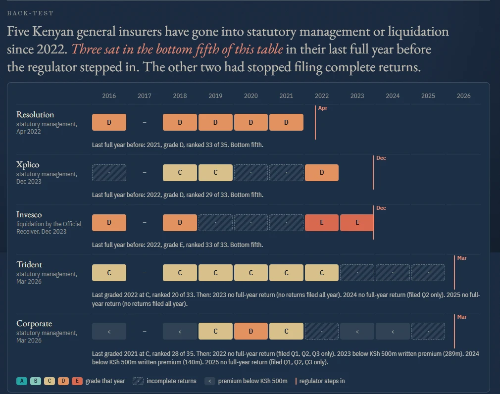
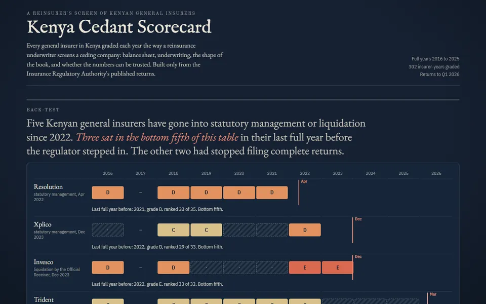

<p align="center">
  
</p>

<h1 align="center">Kenya Cedant Scorecard</h1>

<p align="center">
  <b>If a reinsurer screened every Kenyan general insurer each year,<br>
  who would it worry about, and did the warnings come true?</b>
</p>

<p align="center">
  <a href="https://maidenpeter.github.io/ira-kenya-reinsurance/page/kenya-cedant-scorecard.html"><b>Open the scorecard</b></a>
  &nbsp;|&nbsp; <a href="#did-it-see-the-failures-coming">The back-test</a>
  &nbsp;|&nbsp; <a href="#2025-at-a-glance">2025 at a glance</a>
  &nbsp;|&nbsp; <a href="#how-the-score-works">How the score works</a>
  &nbsp;|&nbsp; <a href="#caveats">Caveats</a>
  &nbsp;|&nbsp; <a href="#why-i-built-this">Why I built this</a>
</p>

<p align="center"><sub>A portfolio project by Marion Peter. From the Insurance Regulatory Authority's unaudited returns. A screening view, not a credit opinion.</sub></p>

<p align="center">
  <a href="https://maidenpeter.github.io/ira-kenya-reinsurance/page/kenya-cedant-scorecard.html"></a>
</p>

## In one minute

Before a reinsurer accepts business it asks four questions of the insurer ceding it. Does this company make money on its underwriting? Is its balance sheet strong enough to stand behind the business? What kind of book is it, and how much of the risk does it keep? Can its numbers be trusted? This repo answers those questions for 43 insurers across nine years (302 company-years), using nothing but public data.

<table>
  <tr>
    <td align="center" width="25%"><b>Balance sheet</b><br><sub>Is it strong enough to stand behind the business?</sub><h3>35</h3></td>
    <td align="center" width="25%"><b>Operating performance</b><br><sub>Does it make money on its underwriting?</sub><h3>35</h3></td>
    <td align="center" width="25%"><b>Business profile</b><br><sub>What kind of book is it, and how much does it keep?</sub><h3>15</h3></td>
    <td align="center" width="25%"><b>Return quality</b><br><sub>Can its numbers be trusted?</sub><h3>15</h3></td>
  </tr>
</table>

Each insurer gets a score out of 100 each year, built from those four pillars with the weights above, and a grade from A to E. Grades are relative: they say where a company stands among Kenyan general insurers that year. They are not credit ratings.

## Did it see the failures coming?

Five Kenyan general insurers have been placed under statutory management or liquidation since 2022. In every case the warning was in IRA's own data at least a year before the regulator acted.

| Insurer | Regulator acted | Last scorecard before | What the data showed |
|---|---|---|---|
| Resolution Insurance | April 2022 | 2021: grade D, 33rd of 35 | Grade D in every year scored |
| Xplico Insurance | December 2023 | 2022: grade D, 29th of 33 | Bottom quintile |
| Invesco Assurance | December 2023 | 2022: grade E, 33rd of 33 | Last place |
| Trident Insurance | March 2026 | 2022: grade C, 20th of 33 | Filed no returns in 2023 and a single quarter in 2024 |
| Corporate Insurance | March 2026 | 2021: grade C, 28th of 35 | Premium shrank to KSh 140m and full-year returns went missing |

Three were in the bottom fifth of the table the year before. The other two dropped out of the scorecard because they stopped filing complete returns, which a reinsurer should treat as a warning in its own right. Five cases is a small sample, and the test cannot show how many low-graded insurers carried on without trouble.

## 2025 at a glance

- 33 insurers scored: 9 graded A, 9 B, 6 C, 9 D.
- Four report negative equity in their general business balance sheet, and two more sit below IRA's minimum capital floor.
- The median insurer keeps 72% of the premium it writes and has run a combined ratio of 103% over the last three years.
- ICEA Lion General, Britam General, The Heritage, Mayfair and Tausi top the table.

<p align="center">
  <a href="https://maidenpeter.github.io/ira-kenya-reinsurance/page/kenya-cedant-scorecard.html"></a>
</p>

## How the score works

The structure follows the building blocks of Best's Credit Rating Methodology, limited to what IRA publishes. Each metric is ranked against the year's peers (percentiles, 0 to 100), averaged within its pillar, and weighted.

| Pillar | Weight | Metrics |
|---|---|---|
| Balance sheet | 35 | Equity over IRA's minimum capital (the higher of KSh 600m and 20% of net earned premium); liquid assets over insurance liabilities; receivables over total assets (to 2023 only, since IFRS 17 nets premiums receivable into the contract liabilities) |
| Operating performance | 35 | Three-year combined ratio; five-year loss ratio volatility; three-year return on equity |
| Business profile | 15 | Size; diversification across classes; retention |
| Return quality | 15 | Errors, warnings and missed filings in IRA's returns over three years |

Grades: A 70 and above, B 55 to 70, C 40 to 55, D 25 to 40, E below 25. Negative equity or equity below the capital floor caps the grade at D, whatever the score.

Watch flags are reported beside every grade as absolute tests: negative equity, below the capital floor, combined ratio above 110% over three years, three straight underwriting losses, an unreliable return, retention under 25%.

The ranking holds up when the weights change. With equal weights for every metric, or for every pillar, the order correlates at 0.97 to 0.99 with the base case in every year (`output/sensitivity.csv`). Full method and caveats: `docs/methodology.md`.

## Files

| File | What it holds |
|---|---|
| `output/cedant_scorecard.csv` | Grade, score, pillar scores, percentile of every metric and watch flags, per insurer and year |
| `output/cedant_metrics.csv` | The underlying metrics in KSh millions and ratios |
| `output/not_scored.csv` | Insurers left out each year and why |
| `output/backtest.csv` | The five failures against their scorecard history, with sources |
| `output/sensitivity.csv` | Rank correlation and grade changes under alternative weights |
| `page/kenya-cedant-scorecard.html` | The scorecard as a single page: back-test strips, league table by year, how each grade is built. Open it in a browser, or [on the site](https://maidenpeter.github.io/ira-kenya-reinsurance/page/kenya-cedant-scorecard.html) |

## Running it

The data comes from [ira-kenya-data](https://github.com/maidenpeter/ira-kenya-data). Clone both repos side by side (or set `IRA_DATA_DIR`), then:

```
pip install -r requirements.txt
./run.sh
pytest tests
```

The tests pin down the scoring rules (which way each metric counts, the grade bands, the capital cap, who is left out) and check the published scorecard obeys them. GitHub Actions runs them on every push.

## Caveats

- IRA's quarterly returns are unaudited. The balance sheet is the company's general business return; for composite insurers it covers the general fund only.
- Equity is a stand-in for IRA's risk-based capital test, which needs data IRA does not publish. It is the lenient side of that test: IRA reported that 15 of 35 general insurers held less capital than required at December 2023 ([Business Daily](https://www.businessdailyafrica.com/bd/corporate/companies/eyes-on-ira-as-23-insurers-breach-minimum-capital-position-4850574), December 2024), while the equity floor here flags 9 of 34 that year. Passing this floor does not mean passing IRA's test.
- The floor applies today's rule to every year so that years compare like with like. The rule was phased in, with the risk-based part postponed to June 2020 ([Bowmans](https://bowmanslaw.com/insights/key-amendments-insurance-act-cap-487/)), so for 2016 to 2019 it is stricter than what insurers then faced. It caps six grades in those years and none of the back-test grades.
- IRA moved these statements to IFRS 17 from Q1 2024, so some balance sheet metrics are not comparable across that line. Scores are ranked within each year, so every comparison is like with like.
- Everything here is public IRA data. Nothing comes from inside any insurer.

## Why I built this

In 2025 I placed fourth in the Kenya Re AI4 Hackathon with a decision support tool for triaging facultative
reinsurance submissions. Part of that triage is the cedant: before the risk itself, a reinsurer wants to know whether
the insurer passing it on is sound, and whether its numbers can be trusted.

IRA's returns hold enough to ask that of every Kenyan general insurer, every year: the balance sheet, the underwriting
results, the shape of the book and the quality of the filings themselves. I wanted a screen built only from that public
data, simple enough to explain line by line, and then the hard test: would it have flagged the insurers the regulator
later stepped into? Three of the five were in the bottom fifth the year before, and the other two stopped filing
complete returns, which is a warning of its own.

It is a screening view, not a rating. It says where to look first, which is what an underwriter needs before the
detailed work on a submission begins.

---

<p align="center">
  <sub>Part of a portfolio at <a href="https://maidenpeter.github.io/">maidenpeter.github.io</a>, with the data in
  <a href="https://github.com/maidenpeter/ira-kenya-data">ira-kenya-data</a> and the market analysis in
  <a href="https://github.com/maidenpeter/ira-kenya-insurance">ira-kenya-insurance</a>.</sub>
</p>
